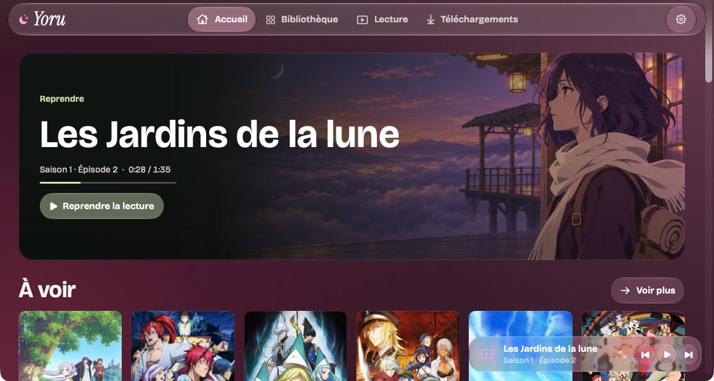
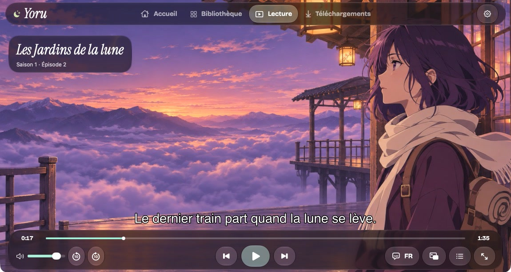
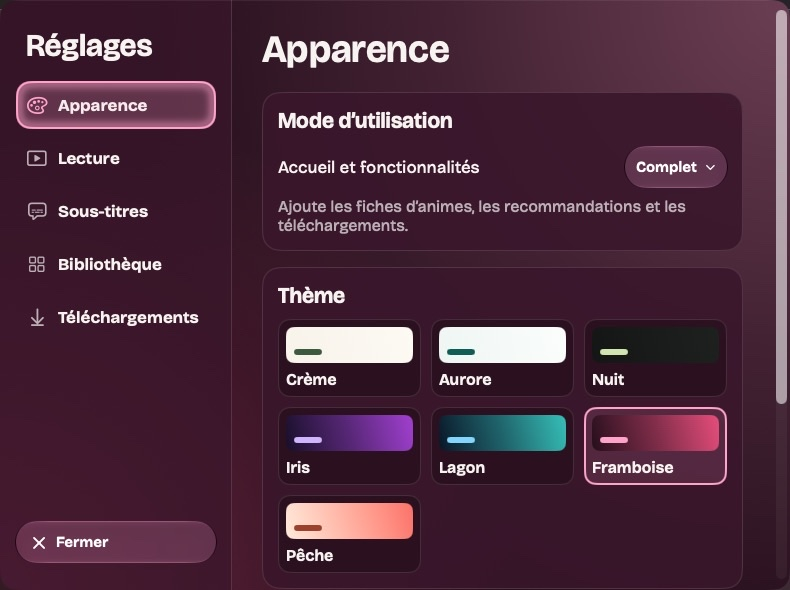

# Yoru

Un lecteur vidéo et une bibliothèque d’animés pour macOS. Yoru lit notamment les fichiers MKV, MP4 et WebM, reprend au dernier passage regardé et regroupe les épisodes par saison.

## Télécharger

Ouvre **Yoru-macOS-universal.dmg**, puis glisse **Yoru Public** dans le dossier **Applications** de la fenêtre. Le même téléchargement contient les versions Intel et Apple Silicon pour macOS Ventura (13) et versions ultérieures. [Télécharger Yoru](https://github.com/TaoEffects/yoru/releases/latest)

Le lecteur vidéo et le moteur BitTorrent sont inclus. Cette édition est signée localement et n’est pas notariée par Apple. Selon la version de macOS, l’ouverture peut demander une autorisation dans Réglages Système. [Aide macOS sur l’ouverture d’une app téléchargée](https://support.apple.com/fr-fr/guide/mac-help/mh40616/mac)

## Aperçu





<details>
<summary>Réglages et écran de bienvenue</summary>




</details>

La scène du lecteur est une illustration originale créée pour la démo. Les affiches de l’accueil viennent du catalogue AniList.

## Commencer

Au premier lancement, choisis **Lecteur** pour ouvrir directement des vidéos, **Bibliothèque** pour les classer et suivre ta progression, ou **Complet** pour ajouter les fiches, les recommandations et les téléchargements. Tu peux changer de mode dans **Réglages → Apparence**.

1. Glisse une vidéo sur Yoru, ou utilise **⌘O**.
2. Pour voir tes séries, ouvre **Bibliothèque** et choisis le dossier qui contient tes vidéos.
3. Pour télécharger, ouvre un fichier `.torrent`, cherche un titre ou lance le téléchargement depuis une recommandation. Yoru peut choisir un pack complet ou les épisodes disponibles d’une série en cours parmi les sources activées. Tu peux aussi choisir une version à la main. Les vidéos terminées apparaissent dans la bibliothèque et le torrent sort de la liste des transferts.

- **Espace** met en pause et **F** bascule en plein écran. La barre de navigation flotte au-dessus de la vidéo et se révèle dans la moitié supérieure en plein écran. Fais défiler la barre à la molette ou au trackpad pour changer d’onglet.
- Par défaut, en lecture, **← / →** reculent ou avancent de cinq secondes et **↑ / ↓** règlent le volume. En pause, les flèches déplacent le focus et **Entrée** valide. Les manettes compatibles macOS utilisent le pavé directionnel, **A** pour valider et **B** pour revenir.
- Le bouton **Image dans l’image** se trouve près des sous-titres. En changeant d’onglet, tu peux garder les commandes dans une bulle, ouvrir la vidéo flottante ou masquer le mini-lecteur.
- Survole la barre du lecteur pour voir l’horodatage et, avec FFmpeg, une image de la scène. Les intros et génériques reconnus sont indiqués sur la barre.
- Un clic gauche sur les sous-titres fait défiler JP, FR et Aucun. Un clic droit ouvre les autres pistes et les réglages de décalage.
- Dans une saison, glisse sur les vignettes ou utilise **Maj + clic** pour changer le statut de plusieurs épisodes en une fois.
- La fiche d’une série reprend le dernier épisode entamé dans la saison choisie. **Corbeille** déplace les vidéos sélectionnées après confirmation.

L’interface est en français. Le Liquid Glass natif est disponible à partir de macOS 26. Les vignettes vidéo utilisent FFmpeg s’il est installé. Les recherches de sous-titres en ligne utilisent tes propres accès Jimaku ou OpenSubtitles, configurables dans les réglages.

## Personnaliser

- **Apparence** propose sept thèmes, les libellés en minuscules, les fonds floutés et l’interface légère.
- **Lecture** permet de choisir la sortie audio et d’afficher son bouton dans le lecteur. Tu peux aussi personnaliser les flèches, les animations des boutons, les sauts, les intros et le mini-lecteur.
- **Sous-titres** permet de choisir la langue préférée et d’inclure l’anglais dans le cycle du bouton.
- **Bibliothèque** permet de masquer les recommandations. **Téléchargements** permet de désactiver le choix automatique des versions et de personnaliser les sources et le minimum de seeders.

## Données et services

Chaque installation publique utilise son propre historique et ses propres réglages. Elle démarre dans `~/Movies/Yoru Public`. Les données de progression restent dans `~/Library/Application Support/Yoru Public`. Les identifiants de services sont dans le Trousseau macOS.

En mode Complet, importe tes exports CSV **Vus** et **À voir** dans **Réglages → Bibliothèque → Nautiljon**. Les titres vus sont écartés des suggestions. **Voir plus** ouvre une galerie avec recherche. Les affiches se chargent au fil du défilement. Un clic ouvre la fiche et ses options de téléchargement.

Yoru utilise AniList pour les fiches et les recommandations, AniZip pour les titres d’épisodes, AniSkip pour certains repères et Nyaa pour les recherches de torrents. Les synopsis peuvent être traduits en français par macOS à partir de la version 15. macOS peut demander de télécharger la langue à la première utilisation. Les sous-titres en ligne utilisent les accès que tu configures.

## Compiler

Sur un Mac avec Xcode 26 ou plus récent sélectionné en ligne de commande, installe *cmake*, *ninja* et *pkg-config*. Depuis la racine du dépôt, exécute les trois scripts dans cet ordre.

```sh
./prepare-mpv.sh
./prepare-torrent.sh
./build.sh
```

L’app est créée dans `build/Yoru Public.app`. Le montage des moteurs et les textes de licence sont décrits dans [THIRD-PARTY.md](THIRD-PARTY.md).

Pour créer le DMG, utilise [dmgbuild](https://dmgbuild.readthedocs.io/en/stable/) avec la configuration fournie.

```sh
swift packaging/render-dmg-background.swift Resources/Fonts build/installer-background.png
dmgbuild -s packaging/dmg-settings.py -D "app=$PWD/build/Yoru Public.app" \
  -D "background=$PWD/build/installer-background.png" Yoru build/Yoru-macOS-universal.dmg
```
